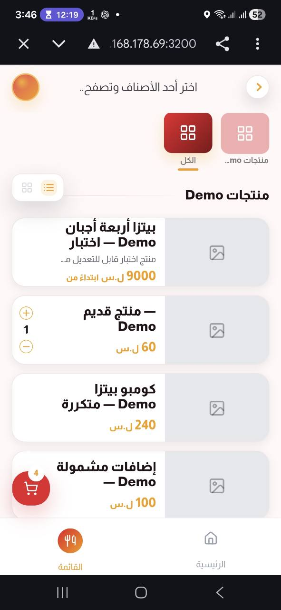
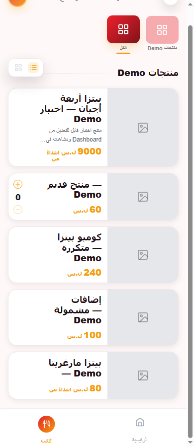

# OrderSawa — إصلاح فتح بطاقات المنتجات ووضوح المنيو على الموبايل

التاريخ: 25 أكتوبر 2026. الفرع: `feature/product-configuration-network`. نقطة البداية: `3417da8b3ebd9499a4fe9fa20601c47ba13e8df9`. Commit إصلاح الكود والاختبار: `4d790f450d5f3430a6dcb90955e55ffe62f32edd`. المقارنة تخص المستودع وبيئة Demo المحلية، لا Production.

## النتيجة والسبب الجذري

1. في تخطيط صفوف القائمة، جعلت `display: contents` زر فتح المنتج بلا صندوق نقر (`0×0` في فحص المتصفح). أصبح الزر Grid حقيقيًا يغطي مساحة البطاقة؛ بقي زر كمية Legacy عنصرًا مستقلًا فوقه، فلا يؤدي الضغط على `+` أو `−` إلى التنقل.
2. في البطاقة الكبيرة، كان `setPointerCapture` يحدث عند بداية ضغط الماوس، فيسحب حدث `click` من أزرار الصورة والعنوان. أصبح الالتقاط عند تحقق سحب أفقي فعلي (40px)، ثم تُحرَّر المؤشرة فقط إذا كانت ملتقطة. بقي سلوك السحب باللمس منفصلًا.
3. المسار `/m/[slug]` يبدأ بقيمة route خاصة بـsubdomain قبل أن تُحدِّثها `useEffect`. عند الضغط مبكرًا قد يتولد `/product/...` بدل `/m/preview-ordersawa/product/...`. أصبح قرار PAGE وقت النقر يستخدم Host الفعلي، مع المحافظة على `productHref` والوجهة المقصودة ومعامل الرجوع. فرع `double` الذي يفتح Modal لم يتغير.
4. وكيل معاينة LAN المحلي، خارج المستودع، كان يرفض `%2F` حتى داخل معامل `from`، فيرجع 404 `Demo route unavailable`. ثبت ذلك بطلبين لنفس صفحة المنتج: **200** دون `from` و**404** معه. عُدّل فحص السلامة في `work/ordersawa-lan-full-demo-proxy.cjs` ليطبّق على `pathname` وحده، ثم أُعيد تشغيل وكيل Demo. الطلب نفسه صار **200**. هذا ليس تغييرًا في تطبيق Production ولا في API أو مسار المنتج، والملف خارج Git/حزمة الإصدار.

## القراءة على الموبايل

- شريط الأقسام المصوّر يحتفظ بالتمرير الأفقي، لكن الشريحة تتمدد لاسم القسم بدل `ellipsis` بعرض 64px. لم يتغير نمط `text-tabs`.
- بطاقة القائمة تحتفظ بالصورة واللون والشكل الأصليين، وتزداد ارتفاعًا فقط عند حاجة الاسم/الوصف/السعر؛ يظهر الوصف حتى سطرين، مع فاصل أوضح قبل السعر.
- قياس Chrome بعد الإصلاح: زر المنتج `311×157px` عند 360px، و`341×157px` عند 390px، و`396×126px` عند 430px. لم يُرصد تداخل الاسم مع السعر في هذه العينات.

## Modal وصفحة التفاصيل

`ProductQuickViewModal` ومحتواه وقرار فتحه في تخطيط `double` **لم تُعدّل**. نافذة الـModal كانت ظاهرة وما زالت ظاهرة في جلسة العرض الثنائية السابقة. لم ننقل Network إليها ولم نغيّر إعدادات Dashboard أو معنى `productOpenMode`. اختبارات النقر أعادت صفحة التفاصيل الأصلية في تخطيط `single`، وأثبتت الرجوع منها إلى المنيو. ظهرت صفحة Network للمنتج التجريبي المحفوظ من Dashboard؛ لم نغيّر ترتيب أقسامها أو محرك تكوينها.

لا توجد صورة baseline موثوقة لنفس الـModal في Production لإثبات Pixel-perfect. جلسة الـModal القديمة وعينة المصدر بعد الإصلاح تؤكدان عدم تغيير المكوّن، لا تطابقًا بصريًا مطلقًا. كذلك لم نغيّر قاعدة اختيار PAGE/MODAL الحالية رغم اختلافها المحتمل عن حقل `productOpenMode`؛ يحتاج ذلك قرارًا منفصلًا من المؤسس إذا أُريد تعديله مستقبلًا.

## نتائج التحقق الفعلية

| الاختبار | النتيجة |
|---|---|
| Chrome على Next المحلي: 360/390/430/1280px، الاسم، موضع السعر، الشريحة | 4/4 ناجحة |
| Chrome على LAN بعد تصحيح وكيل Demo: المقاسات نفسها | 4/4 ناجحة |
| نقر اسم المنتج، منطقة الصورة، Enter، لمس الموبايل، البطاقة الكبيرة، الرجوع | 6/6 ناجحة محليًا و6/6 عبر LAN |
| زر زيادة كمية Legacy دون فتح المنتج | ناجح محليًا وعبر LAN؛ تغيّر 0→1 في Local Storage لملف Chrome التجريبي فقط |
| لغة إنجليزية LTR | ناجحة محليًا وعبر LAN |
| Web Tests | 12 ملفات اختبار، 64/64 ناجحة، 0 فشل |
| Root Typecheck | ناجح |
| Root Build | ناجح، Next.js 15.5.19 |

اختبار المتصفح اليدوي قابل للإعادة: `node scripts/product-card-browser-regression.mjs` محليًا، أو بضبط `CARD_QA_ORIGIN=http://192.168.178.69:3200` في بيئة Demo نفسها. لا يتصل السكربت بقاعدة البيانات ولا يرسل WhatsApp، ويحصر الـOrigin محليًا. لم نختبر صورة منتج حقيقية لأن جميع منتجات Demo الحالية بلا `imageUrl`؛ جرى اختبار مساحة الصورة البديلة. لم يُنشأ Fixture `double` جديد لأن المهمة تمنع تغيير إعدادات المنيو، لذا لا نحتسب مقارنة Modal قبل/بعد كاختبار Browser قابل للإعادة. لم تُنفَّذ مقارنة Pixel-perfect أو اختبار على هاتف مادي في هذا العمل.

## صور المقارنة

صورة «قبل» هي اللقطة التي قدّمها المؤسس من هاتفه؛ تختلف أبعاد المتصفح وأوقات تحميل البيانات عن صور Chrome الآلية «بعد»، لذلك المقارنة تفسيرية وليست Pixel-perfect.

| قبل | بعد 390px |
|---|---|
|  |  |

لقطات إضافية: [360px](docs/qa/product-card/menu-after-lan-360.png)، [430px](docs/qa/product-card/menu-after-lan-430.png). لقطة الـModal بعد الإصلاح عُرضت في جلسة التحقق، ولم يُحفظ ملف مستقل لها؛ لا يوجد ادعاء مقارنة بصرية قبل/بعد للـModal.

## الملفات والحدود

| الملف | السبب |
|---|---|
| `apps/web/src/app/globals.css` | صندوق الزر، تمدد ارتفاع صف المنتج، قابلية قراءة الشريحة والاسم والوصف والسعر |
| `apps/web/src/components/public/public-menu-client.tsx` | تصحيح Host وقت فتح PAGE وتأخير Pointer Capture في البطاقة الكبيرة فقط |
| `scripts/product-card-browser-regression.mjs` | اختبار Chrome يدوي ومقاسات ولقطات، مع Origin محصور بالـDemo |
| `docs/qa/product-card/*` | لقطة المستخدم قبل الإصلاح ولقطات 360/390/430px بعده |
| `work/ordersawa-lan-full-demo-proxy.cjs` (خارج Git) | السماح بمعامل `from` المشفّر في معاينة LAN المحلية فقط |

ملخص Diff لCommit الكود: **3 ملفات، 267 سطرًا مضافًا، 12 محذوفًا**، ومعظم الإضافات سكربت اختبار (206 أسطر). لم تُعدّل Prisma أو Backend أو Shared Pricing أو Cart/Checkout أو Modal أو إعدادات Production، ولم تُمس بيانات Demo. تقرير التشخيص السابق `ORDERSAWA_PRODUCT_DETAILS_UI_ISSUE_REPORT_AR.md` كان غير متعقب قبل بدء المهمة وبقي خارج Commit الإصلاح؛ قرار المؤسس الحالي بشأن الـModal يعلو على أي تفسير مخالف فيه.

## ملاحظات متبقية

- صورة منتج فعلية وFixture عرض `double` حديثة لم تُختبرا بصريًا؛ يتطلب الاختبار عينات مناسبة دون تغيير إعدادات المطعم الحالي. لا نعدّ ذلك عطلًا مثبتًا.
- وكيل LAN ملف Demo مؤقت خارج المستودع؛ عند إعادة تشغيله يجب استخدام النسخة المعدلة، وإلا يعود رفض معامل `from`. لا يؤثر هذا على Backend أو Production.
- لم يُنفّذ Merge أو Deployment أو تغيير قاعدة بيانات.
